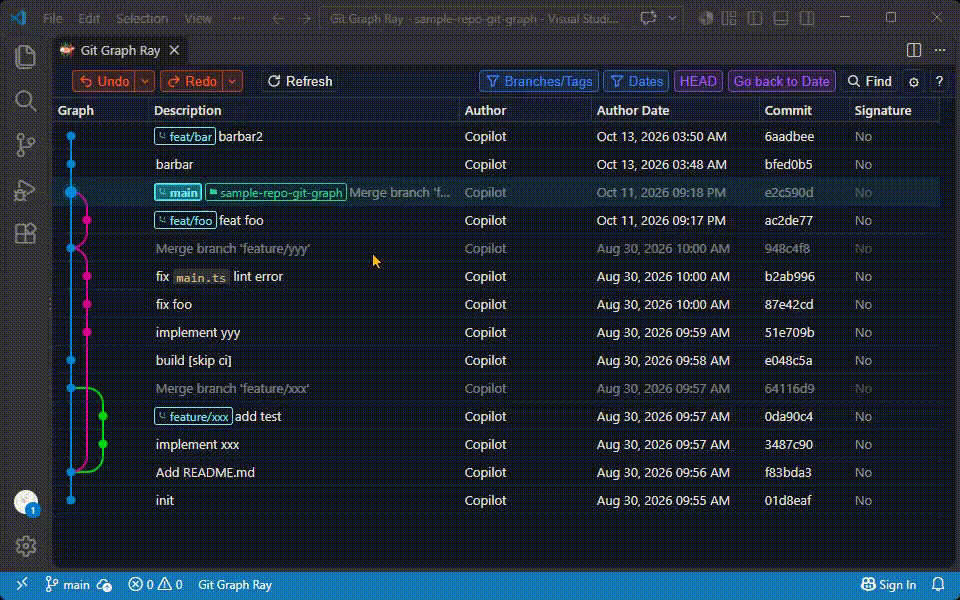
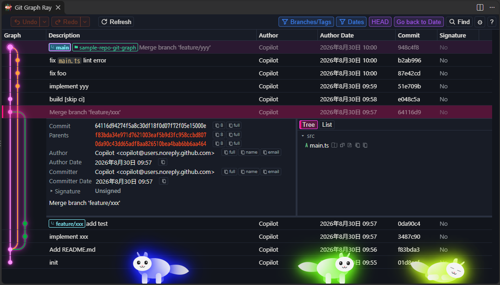
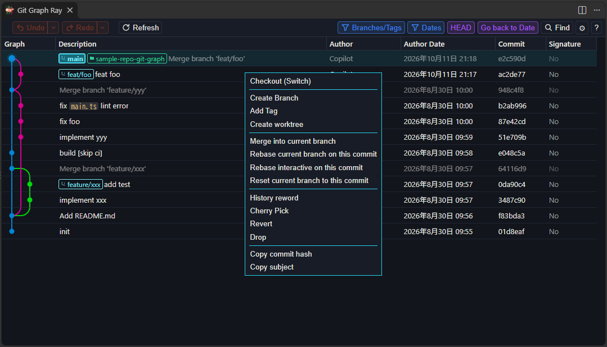
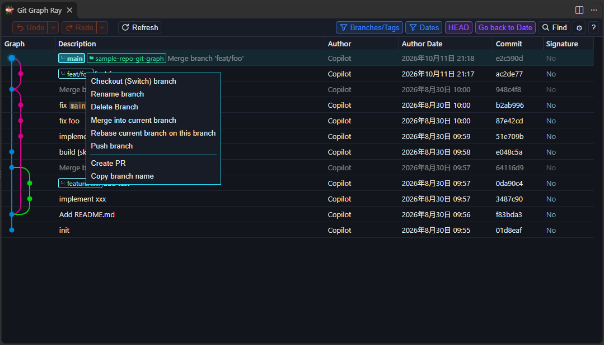
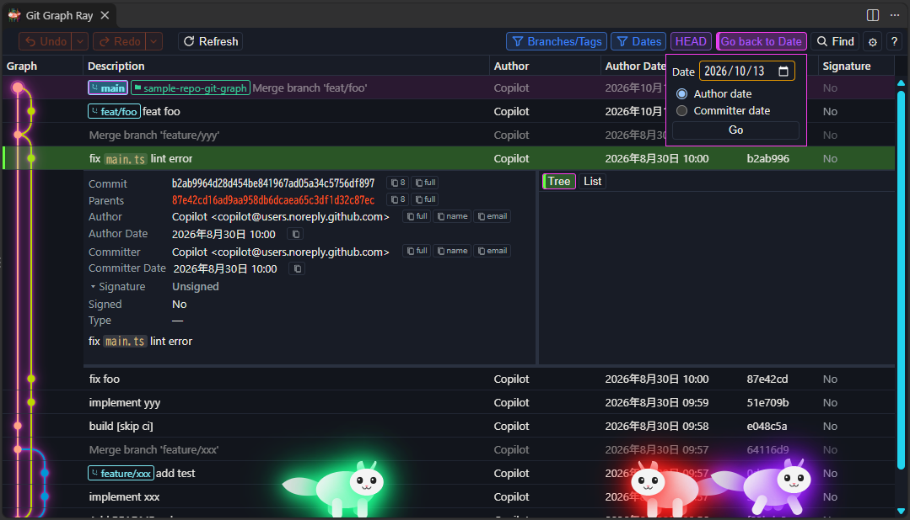
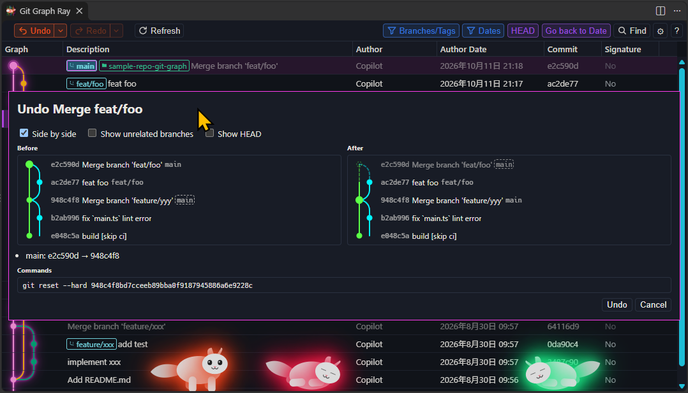

# Git Graph Ray

[English](README.md) | [日本語](README.ja.md)

リポジトリの Git グラフを表示し、そこから Git 操作を実行できます。

コマンドパレット（**Git Graph Ray: View Git Graph**）、SCM のタイトルバー、またはステータスバーからグラフを開けます。コミット、ブランチ、タグ、リモート、stash、worktree をまとめて表示し、エディタを離れずに履歴の確認と操作ができます。

## 機能

- **コミットグラフ** — 色分けされたブランチ、マージ、ref を仮想スクロールの表で表示します。Source Control でのコミットと amend のあと、グラフは自動で再読み込みします（`git-graph-ray.history.autoRefresh`、既定はオン）。列は説明、Author、日付、ハッシュ、署名（署名の有無と GPG / SSH / X.509）です。列ヘッダから表示を切り替え、幅をドラッグで変えられます。Author のアバターは任意です。
- **コミット詳細** — メタデータ、親コミット、本文、ファイル変更を Tree / List で表示します。グラフから diff やリビジョンを開けます。折りたたみの Signature 行に、検証結果と Git が署名から読める項目を出します。Ctrl/Cmd+クリックで2件を選ぶとその差分を表示します。3件以上では詳細を閉じます。
- **共通親からの比較** — 2件の比較は既定で共通親から行います（Since diverge）。片側だけで変わったファイルと両側で変わったファイルを、折りたためる別々のセクションに分けて表示し、ファイルを開くとその側の共通親からの diff を出します。Snapshot で直接の差分に切り替えます。
- **Git 操作** — ブランチ、merge、rebase（対話 rebase は統合ターミナル）、cherry-pick（Shift+クリックで範囲、Ctrl/Cmd+クリックで個別。マージコミットは除く）、revert、reset、reword、amend、squash、drop、tag、stash（選択したファイルだけも可）、pull/push（pull は rebase 可）、worktree、パッチの作成と適用をグラフから実行できます。進行中の操作で衝突しているファイルは、VS Code のマージエディタで開きます。GitHub、GitLab、Bitbucket、またはカスタムの pull request を作成できます。Reword は Git 2.54 以降です。実行した Git コマンドは出力チャンネル **Git Graph Ray** に記録されます。自動 fetch は Repository Settings で有効にするまで止まります。
- **Undo / Redo** — このウィンドウで行ったローカル操作を、ヘッダ（Ctrl/Cmd+Z、Ctrl/Cmd+Shift+Z）または履歴メニューからまとめて戻せます。実行前に、前後のグラフ、ref の変化、走る Git コマンドを確認できます。Source Control でのコミットと amend も対象で、undo は変更をステージに残す `git reset --soft` です。履歴はこのウィンドウに最大 50 件まで残り、worktree 操作と対話 rebase は入りません。
- **リポジトリと worktree** — 入れ子のリポジトリを検出し、フォルダの追加・非表示ができます。worktree は独立したリポジトリとして扱い、作成・オープン・削除もグラフから行えます。
- **フィルタとナビゲーション** — ブランチ / リモート / タグの複数選択ができます。読み込み済みのコミットを Author Date または Committer Date で隠し、グラフ線は隠したコミットをまたいでつながったままです。HEAD や stash へのジャンプ、件名の検索（大文字小文字、正規表現、diff）、マージコミットのミュート、スクロール時の追加読み込みに対応します。
- **Issue リンク** — 正規表現と URL テンプレートで、コミットメッセージ中の issue キーをリンクにします。
- **Contributors** — Contributors タブに、人ごとのコミット数と追加・削除行数を Author または Committer 別に表示します。期間は直近 7 / 30 / 90 日、12 か月、任意の範囲から選べます。Contributor ポップオーバーから Author / Committer でグラフを絞り込めます。
- **テーマ** — Classic、Ray、Ray Wave、Ray Cycle、Ray Stream。グラフの背景は既定で dark です。light、または VS Code のテーマに従う auto を選べます（`git-graph-ray.graph.background`）。ビュー下部に Ray Cat を表示できます。

## 必要環境

- Visual Studio Code 1.120 以降
- PATH 上で利用できる Git

## コマンド

| コマンド | 説明 |
| --- | --- |
| **Git Graph Ray: View Git Graph** | 現在のワークスペースのグラフを開く |
| **Git Graph Ray: View Contributors** | Contributors タブを開く |
| **Git Graph Ray: Fetch from Remote(s)** | リモートを fetch してグラフを開く |
| **Git Graph Ray: Add Git Repository...** | 自動検出されなかったリポジトリを追加する |
| **Git Graph Ray: Remove Git Repository...** | グラフからリポジトリを非表示にする |
| **Git Graph Ray: Clear Avatar Cache** | キャッシュした Author のアバターを消す |
| **Git Graph Ray: Get Version Information** | 拡張のバージョンと Git のバージョンを表示し、コピーできる |

## ショートカット

既定値です。Find、Refresh、Jump to HEAD、Jump to stash は設定で変更できます。グラフにフォーカスがある間、Refresh と Jump to stash の既定のキーは VS Code の Open Recent、Reload Window、Save より優先されます。

| 操作 | ショートカット |
| --- | --- |
| Undo | Ctrl/Cmd+Z |
| Redo | Ctrl/Cmd+Shift+Z |
| Find | Ctrl/Cmd+F |
| 次を検索 / 前を検索 | F3 / Shift+F3 |
| Refresh | Ctrl/Cmd+R |
| Jump to HEAD | Ctrl/Cmd+H |
| Jump to stash | Ctrl/Cmd+S |
| 前の stash へジャンプ | Ctrl/Cmd+Shift+S |
| 次 / 前のコミットを選択 | ↓ / ↑ |
| コミット詳細を開く / 閉じる | Enter |

## 設定

設定キーは v0.8 で変更されました。古い値は新しいキーへ自動的にコピーされます。詳しくは [CHANGELOG](CHANGELOG.md) と [docs/upgrade.md](docs/upgrade.md) を参照してください。

## スクリーンショット

## ライセンス

[MIT](https://github.com/nohi/git-graph-ray)
