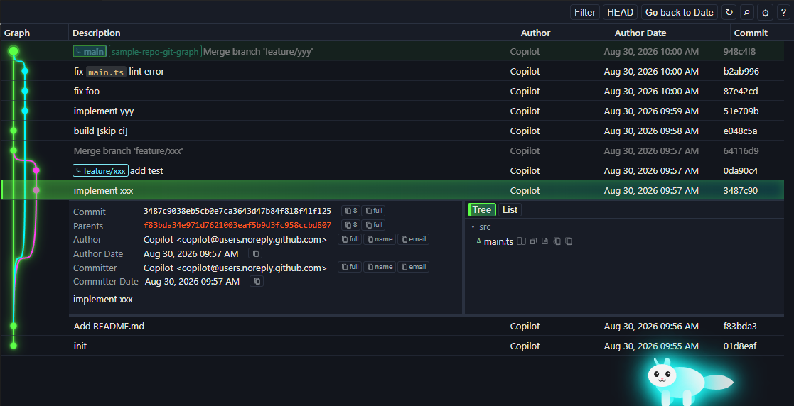

# Git Graph Ray

[English](README.md) | [日本語](README.ja.md)

View a Git graph of your repository and run Git actions from it.

Open the graph from the Command Palette (**Git Graph Ray: View Git Graph**), the SCM title bar, or the status bar. Commits, branches, tags, remotes, stashes, and worktrees are shown together so you can inspect history and act on it without leaving the editor.

## Features

- **Commit graph** — Color-coded branches, merges, and refs in a virtualized table. Columns cover the description, author, dates, hash, and signature (signed or not, and GPG / SSH / X.509). Show or hide columns from the header and drag to resize them. Author avatars are optional.
- **Commit details** — Metadata, parents, body, and file changes in Tree or List view. Open diffs and revisions from the graph. A collapsible Signature row shows verification and the fields Git can read from the signature. Ctrl/Cmd+click a second commit to compare.
- **Git actions** — Branch, merge, rebase (interactive rebase opens in the integrated terminal), cherry-pick, revert, reset, reword, drop, tag, stash, pull/push, and worktree operations from the graph. Create pull requests for GitHub, GitLab, Bitbucket, or a custom provider. Reword needs Git 2.54 or later. Each Git command is written to the **Git Graph Ray** output channel.
- **Undo and Redo** — Step through local Git operations from the header (Ctrl/Cmd+Z, Ctrl/Cmd+Shift+Z) or several steps at once from the history menu. Preview the before and after graphs, ref changes, and the commands that will run. Commits and amends from Source Control are included and undone with `git reset --soft`, so the changes stay staged. History stays in the window (up to 50 entries). Worktree operations and interactive rebase are left out of that history.
- **Repositories and worktrees** — Discover nested repos, add or hide folders, and treat worktrees as first-class repos. Create, open, and remove worktrees from the graph.
- **Filtering and navigation** — Multi-select branches, remotes, and tags. Hide loaded commits by author date or committer date while the graph line stays connected. Jump to HEAD or a stash, search subjects (match case, regular expression, or diffs), mute merge commits, and load more history as you scroll.
- **Issue linking** — Turn issue keys in commit messages into links with a regex and a URL template.
- **Themes** — Classic, Ray, Ray Wave, Ray Cycle, and Ray Stream. Ray Cat can sit along the bottom of the view.

## Requirements

- Visual Studio Code 1.120 or later
- Git available on your PATH

## Commands

| Command | Description |
| --- | --- |
| **Git Graph Ray: View Git Graph** | Open the graph for the current workspace |
| **Git Graph Ray: Fetch from Remote(s)** | Fetch remotes and open the graph |
| **Git Graph Ray: Add Git Repository...** | Add a repository that was not discovered automatically |
| **Git Graph Ray: Remove Git Repository...** | Hide a repository from the graph |
| **Git Graph Ray: Clear Avatar Cache** | Clear cached author avatars |
| **Git Graph Ray: Get Version Information** | Show the installed extension version |

## Shortcuts

Defaults. Find, Refresh, Jump to HEAD, and Jump to stash can be reassigned in settings.

| Action | Shortcut |
| --- | --- |
| Undo | Ctrl/Cmd+Z |
| Redo | Ctrl/Cmd+Shift+Z |
| Find | Ctrl/Cmd+F |
| Find next / previous | F3 / Shift+F3 |
| Refresh | Ctrl/Cmd+R |
| Jump to HEAD | Ctrl/Cmd+H |
| Jump to stash | Ctrl/Cmd+S |

## License

[MIT](https://github.com/nohi/git-graph-ray)
